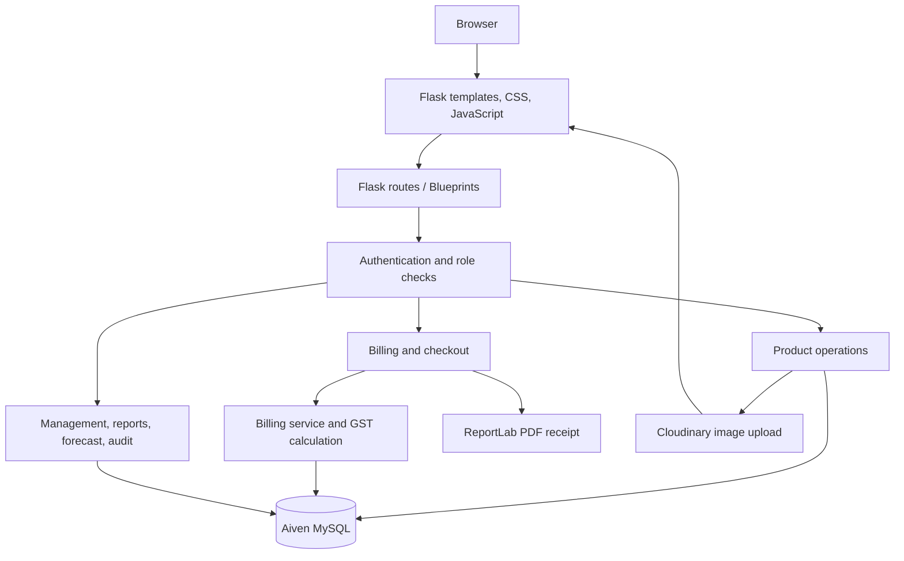

# Billora V2.0

### Smart Billing & Retail Management System

Billora is a Flask-based retail billing and management application backed by MySQL. It combines product and inventory management, checkout, GST calculation, automatic discounts, customer loyalty, payment recording, sales reporting, demand forecasting, restocking recommendations, and audit history in one web application.

> **Release:** V2.0  
> **Backend:** Python, Flask  
> **Database:** MySQL  
> **Production web host:** Render  
> **Database host:** Aiven MySQL  
> **Image storage:** Cloudinary  
> **PDF generation:** ReportLab

## Table of contents

- [1. Project goals](#1-project-goals)
- [2. Features](#2-features)
- [3. Technology stack](#3-technology-stack)
- [4. Architecture and request flow](#4-architecture-and-request-flow)
- [5. Repository structure](#5-repository-structure)
- [6. Modules and responsibilities](#6-modules-and-responsibilities)
- [7. Algorithms and business rules](#7-algorithms-and-business-rules)
- [8. Database design](#8-database-design)
- [9. Routes and endpoints](#9-routes-and-endpoints)
- [10. Local installation](#10-local-installation)
- [11. Environment variables](#11-environment-variables)
- [12. Deployment](#12-deployment)
- [13. Security notes](#13-security-notes)
- [14. Testing checklist](#14-testing-checklist)
- [15. Known implementation details](#15-known-implementation-details)
- [16. Version history](#16-version-history)

## 1. Project goals

Retail billing involves more than adding prices. A shop also needs accurate tax calculations, current stock, transaction history, payment records, customer retention tools, and a way to understand sales trends. Billora brings these workflows together and provides role-based access for administrators and cashiers.

The project is also designed to demonstrate practical full-stack development: Flask routing, relational database operations, session-based authentication, business-rule implementation, external image storage, PDF generation, reporting, and production deployment.

## 2. Features

### 2.1 Authentication and role separation

- Login and logout using Flask sessions.
- Passwords are stored as hashes using Werkzeug password-hashing functions.
- Two roles are supported: `admin` and `cashier`.
- Administrative routes are protected by an admin-only decorator.
- Registration is restricted to initial account setup; after an account exists, public registration is disabled.
- Unauthenticated API requests receive an authentication error, while page requests redirect to login.

### 2.2 Product and inventory management

- Add products with name, price, GST percentage, stock quantity, and optional image.
- Edit product information and optionally replace its image.
- Soft-delete products by marking them inactive rather than immediately deleting their records.
- Validate positive prices, non-negative stock, and GST percentages from 0 to 100 in product routes.
- Display active products in product and billing views.
- Configure a low-stock threshold using `LOW_STOCK_THRESHOLD`.
- Create low-stock alerts and resolve open alerts when inventory rises above the threshold.

### 2.3 Product image storage

- Accepts JPG, JPEG, PNG, and WEBP image extensions.
- Uses a sanitized filename check and generates a UUID-based Cloudinary public ID.
- Uploads product images to the `billora/products` Cloudinary folder.
- Stores the returned secure HTTPS URL as the product image reference.
- Cloudinary credentials are read from environment configuration, not embedded in source code.

### 2.4 Billing and checkout

- Build a cart from product IDs and requested quantities.
- Retrieve product prices and GST rates from the server-side database rather than trusting client-supplied prices.
- Reject invalid or non-positive quantities and reject quantities exceeding available stock.
- Calculate item subtotals, discounts, GST, and the final amount on the server.
- Save the bill and its line items to MySQL.
- Deduct sold quantities from inventory with a conditional stock update.
- Record the cashier and, where provided, the customer against the bill.
- Generate a PDF receipt after checkout.

### 2.5 Automatic discounts

The current billing service calculates an automatic percentage discount based on the pre-discount cart subtotal:

| Subtotal | Automatic discount |
|---:|---:|
| Below ₹1,000 | 0% |
| ₹1,000 to below ₹2,000 | 5% |
| ₹2,000 to below ₹5,000 | 10% |
| ₹5,000 and above | 15% |

The discount is allocated proportionally across cart lines before GST is calculated. The checkout endpoint does not treat a client-submitted discount amount as authoritative.

### 2.6 GST calculation

- Each product has a configured GST percentage.
- GST is calculated at item level after the discount allocation.
- The billing service aggregates item-level GST to obtain the bill GST total.
- Monetary values in the main billing service use Python `Decimal` with two decimal places and `ROUND_HALF_UP` rounding.

The current service treats the product price as the pre-tax unit price and adds GST to the discounted taxable amount. Confirm that this matches the shop's intended tax and pricing policy before using Billora for real commercial accounting.

### 2.7 Multiple payment methods and split payments

- Supported methods in the current checkout code: cash, card, and UPI.
- A single payment is recorded for the server-calculated final bill total.
- Split payments can use multiple payment entries.
- Split-payment amounts must be positive and must sum exactly to the final bill total after rounding.
- Payment records are stored in `bill_payments` and associated with a bill ID.

Billora records payment methods and amounts; this is not a payment-gateway integration and does not itself process card or UPI transfers.

### 2.8 Customer management and loyalty points

- Create and maintain customer records with name, phone, email, and address.
- Phone numbers are unique when supplied, according to the database constraint.
- Associate a customer with a bill.
- Track current and lifetime loyalty points.
- Redeem points during checkout for registered customers, subject to the customer's available balance and server-side limits.
- Award points based on eligible pre-tax spend.

Current loyalty rules in `services/billing_service.py`:

- 100 points represent ₹10, so one point represents ₹0.10.
- Redemption is capped at 20% of the subtotal after the automatic discount.
- Customers earn one point for each full ₹100 of eligible pre-tax spend.
- Loyalty redemption is applied before GST.

The checkout route is responsible for checking that the customer exists and has enough points before accepting redemption.

### 2.9 Dashboard and sales analytics

The admin dashboard uses SQL aggregation to summarize a configurable recent period (30 days by default). The analytics module provides:

- Number of bills
- Total revenue
- Total GST collected in recorded bills
- Daily bill counts and revenue
- Top products ranked by units sold
- Product sales revenue

### 2.10 Sales forecasting

The forecast module estimates demand from historical sales in a recent window (30 days by default). For each active product, it calculates:

- Units sold in the selected historical window
- Average daily sales
- A simple 30-day unit-sales projection
- Suggested restock quantity based on projected demand minus current stock

This is a **simple historical-average projection**, not a trained machine-learning model. It does not, by itself, account for seasonality, promotions, supplier lead times, or future business changes.

### 2.11 Automated restocking recommendations and low-stock alerts

- Products are compared against a configurable stock threshold.
- Low-stock products are listed with current stock and recent sales context.
- Restock recommendations use the simple sales forecast and current stock.
- Open inventory alerts are retained in `inventory_alerts` and can be resolved when stock rises above the threshold.

The suggested restock quantity is a planning aid, not an automatic purchase order.

### 2.12 Reports and CSV export

- Filter sales report rows by optional start and end dates.
- Show bill date, customer, cashier, payment method, subtotal, GST, and total.
- Export the report to CSV for spreadsheet analysis.

### 2.13 Activity history and audit logs

- Record actions with user ID, action name, entity type, optional entity ID, JSON details, and timestamp.
- Record checkout completion and selected product, customer, and user-management actions.
- Display the most recent audit events to administrators.
- Associate audit events with a username when the user record is available.

The audit trail is application-level logging. It should not be described as tamper-proof or immutable storage.

### 2.14 PDF receipt generation

- Generates PDF receipts using ReportLab.
- Supports configured 58 mm or 80 mm receipt widths.
- Includes shop name, address, optional phone and GSTIN, receipt number, date/time, customer, item details, tax, discount, and total information as available in the bill data.
- Writes generated PDFs to `static/bills/` using the bill ID in the filename.

Generated PDFs stored on the app filesystem may not survive every host replacement or redeployment. Keep this in mind if permanent receipt retention is required.

### 2.15 Billing history and protected pages

- Provides billing page and bill-history routes.
- Uses a shared base template and separate templates/styles for products, billing, reports, dashboard, customers, inventory alerts, forecast, users, and audit history.
- Requires an authenticated session for application pages and APIs except explicitly public authentication and static endpoints.

## 3. Technology stack

| Technology / package | Purpose |
|---|---|
| Python | Backend language and business logic |
| Flask 3.1.0 | Web framework and routing |
| Flask-MySQLdb 2.0.0 | Flask integration with MySQL |
| mysqlclient 2.2.7 | MySQL database driver |
| python-dotenv 1.0.0 | Load local environment configuration |
| ReportLab 4.1.0 | PDF receipt generation |
| Gunicorn 23.0.0 | Production WSGI server |
| Cloudinary Python SDK 1.44.1 | Product image uploads and hosted image URLs |
| Werkzeug | Password hashing, request utilities, and Flask support |
| MySQL / Aiven | Relational persistence |
| HTML, Jinja templates, CSS | Server-rendered UI and layout |
| JavaScript | Client-side product and billing interactions |
| Render | Application hosting and deployment |

The exact pinned Python dependencies are listed in `requirements.txt`.

## 4. Architecture and request flow



Typical checkout flow:

1. The browser submits cart items and payment details to the checkout API.
2. The server validates the request and checks customer/loyalty eligibility.
3. Product records are retrieved from MySQL to obtain trusted prices, tax rates, and stock.
4. The billing service calculates automatic discounts, loyalty redemption, GST, and total.
5. The route validates the payment method or split-payment amounts.
6. The billing model writes the bill, line items, inventory updates, payment records, loyalty changes, low-stock alerts, and audit event.
7. The receipt PDF is generated and the checkout response is returned.

## 5. Repository structure

```text
Billing_System/
├── app.py                         # Flask application setup and session guard
├── config.py                      # Environment-backed configuration
├── extensions.py                  # Flask-MySQLdb extension
├── requirements.txt               # Pinned Python dependencies
├── Procfile                       # Production start command
├── runtime.txt                    # Python runtime declaration
├── migrations/
│   ├── 001_reporting_and_roles.sql
│   └── 002_loyalty_payments_audit.sql
├── models/
│   ├── schema.py                  # Additive schema upgrades
│   ├── user_model.py              # User records and password-hash storage
│   ├── admin_model.py             # User listing and role changes
│   ├── product_model.py           # Product CRUD and lookups
│   ├── billing_model.py           # Bills, bill items, stock, payments, loyalty
│   ├── customer_model.py          # Customer records
│   ├── analytics_model.py         # Dashboard, low stock, forecast, reports
│   └── audit_model.py             # Audit event writing and reading
├── routes/
│   ├── auth.py                    # Login, initial registration, logout
│   ├── access.py                  # Admin-only decorator
│   ├── products.py                # Product routes and Cloudinary uploads
│   ├── billing.py                 # Checkout, payment validation, history
│   └── management.py              # Dashboard, customers, reports, forecast, audit
├── services/
│   ├── billing_service.py         # Discounts, loyalty, subtotal, GST, totals
│   └── gst_service.py             # Standalone GST calculation helper
├── utils/
│   └── pdf_generator.py           # Thermal receipt PDF generation
├── templates/                     # Jinja HTML templates
├── static/
│   ├── css/                       # Page stylesheets
│   ├── js/                        # Product and billing interactions
│   ├── uploads/products/          # Local folder placeholder; Cloudinary is used
│   └── bills/                     # Generated receipt output folder
└── README.md
```

## 6. Modules and responsibilities

### Application and configuration

- `app.py`: creates the Flask app, loads `Config`, initializes MySQL, registers Blueprints, configures session defaults, and redirects users to billing or login.
- `config.py`: loads DB, session, debug, low-stock, and Cloudinary settings from environment variables.
- `extensions.py`: exposes the shared `MySQL` extension.

### Routes

- `routes/auth.py`: sign-in, one-time initial registration, sign-out, password verification, session setup, and safe post-login redirects.
- `routes/access.py`: `admin_required` decorator for administrative pages and actions.
- `routes/products.py`: product listing, creation, editing, soft deletion, validation, and Cloudinary uploads.
- `routes/billing.py`: customer quick-create, payment validation, checkout, product data for billing, billing page, and history page.
- `routes/management.py`: dashboard, inventory alerts, forecast, customer management, reports, CSV export, user administration, role changes, and audit-log page.

### Models / data access

- `models/user_model.py`: creates/queries user records and stores password hashes and roles.
- `models/admin_model.py`: lists users and changes their roles.
- `models/product_model.py`: reads, inserts, updates, soft-deletes, and looks up products using parameterized SQL.
- `models/billing_model.py`: persists bill headers and line items, decrements stock, records payments, updates loyalty points, manages low-stock alerts, and logs checkout.
- `models/customer_model.py`: lists, reads, and saves customer records.
- `models/analytics_model.py`: SQL-based dashboard summaries, low-stock query, average-sales forecast, and date-filtered report rows.
- `models/audit_model.py`: writes JSON-detail audit events and retrieves recent events.
- `models/schema.py`: checks for columns and creates/adds application schema elements for roles, customers, loyalty, payments, audit logs, and inventory alerts.

### Services and utilities

- `services/billing_service.py`: uses `Decimal` arithmetic to calculate subtotal, automatic discount, loyalty redemption, proportional discount allocation, GST, final total, and earned points.
- `services/gst_service.py`: standalone helper that calculates subtotal, GST, and tax-inclusive total for a price, quantity, and rate.
- `utils/pdf_generator.py`: formats and writes compact thermal receipt PDFs with ReportLab.

## 7. Algorithms and business rules

### 7.1 Money and rounding

The main billing service converts values through `Decimal(str(value))`, quantizes to two decimal places, and uses `ROUND_HALF_UP`. This is intended to reduce common floating-point rounding errors in currency calculations.

### 7.2 Subtotal

For each valid cart item:

\[
\text{line subtotal}_i = \text{unit price}_i \times \text{quantity}_i
\]

\[
\text{subtotal} = \sum_i \text{line subtotal}_i
\]

The product price and GST rate are loaded from the database. The quantity must be an integer greater than zero and cannot exceed the product's current stock according to the service-level validation.

### 7.3 Automatic discount selection

Let `S` be the cart subtotal before discounts:

\[
D(S)=\begin{cases}
0 & S < 1000\\
0.05S & 1000 \le S < 2000\\
0.10S & 2000 \le S < 5000\\
0.15S & S \ge 5000
\end{cases}
\]

The selected discount amount is rounded to two decimal places. The code selects exactly one tier based on the subtotal.

### 7.4 Loyalty redemption and earning

- Point value: ₹0.10 per point.
- Maximum redemption amount: 20% of the subtotal after automatic discount.
- Points usable are limited by both the requested amount and the configured redemption cap; the route separately checks the customer's available balance.
- Redemption value is subtracted before GST.
- Points earned: one point for each full ₹100 of eligible pre-tax spend, using floor rounding.

Conceptually:

\[
\text{eligible net} = \text{subtotal} - \text{automatic discount} - \text{loyalty redemption}
\]

\[
\text{points earned} = \left\lfloor\frac{\text{eligible net}}{100}\right\rfloor
\]

### 7.5 Proportional discount allocation

The billing service spreads the post-discount taxable amount across individual cart lines in proportion to their original subtotals:

\[
\text{ratio} = \frac{\text{eligible net}}{\text{subtotal}}
\]

\[
\text{discounted line base}_i = \text{line subtotal}_i \times \text{ratio}
\]

The implementation rounds each line base to cents, calculates GST for that line, and adds the rounded line totals to obtain the final total. Because rounding occurs at item level, totals can differ by a small amount from a calculation that rounds only once at the very end.

### 7.6 GST per item

For each item, the billing service calculates:

\[
\text{GST}_i = \text{discounted line base}_i \times \frac{\text{GST rate}_i}{100}
\]

\[
\text{line total}_i = \text{discounted line base}_i + \text{GST}_i
\]

The bill GST is the sum of the rounded item-level GST amounts, and the final amount is the eligible net amount plus total GST.

### 7.7 Payment validation

The accepted payment methods are `cash`, `card`, and `upi`. For a single payment, the server uses the calculated bill total as the payment amount. For split payment, each entry must have a valid method and a positive amount, at least two entries are required, and the rounded sum must equal the final bill total.

This validates and records payment allocation; it does not charge a payment gateway.

### 7.8 Stock update and low-stock detection

The database update uses a conditional statement equivalent to:

```sql
UPDATE products
SET stock = stock - %s
WHERE id = %s AND stock >= %s;
```

The affected-row count is checked. If stock is insufficient, the billing model rolls back and rejects the save. After stock changes, the model checks products against the configured threshold, creates an open alert if one does not already exist, and resolves open alerts for products whose stock rises above the threshold.

### 7.9 Sales analytics

Dashboard metrics are computed using SQL aggregates and date filters:

- `COUNT(*)` for bill count.
- `SUM(total)` for revenue.
- `SUM(gst_amount)` for recorded GST.
- `GROUP BY DATE(created_at)` for daily sales.
- Aggregated bill-item quantities for best-selling products.

### 7.10 Forecast and restocking

For a historical period of `N` days:

\[
\text{average daily sales} = \frac{\text{units sold in N days}}{N}
\]

\[
\text{30-day forecast} = \max(0,\operatorname{round}(\text{average daily sales} \times 30))
\]

\[
\text{suggested restock} = \max(0,\text{30-day forecast} - \text{current stock})
\]

This is a simple moving historical average, not a machine-learning forecast. The implementation does not include a trained model, seasonality analysis, supplier lead-time model, or confidence interval.

### 7.11 Audit logging

Audit events are inserted into `audit_logs` with the actor ID, action, entity type, optional entity ID, JSON details, and timestamp. The admin audit page queries the latest events in descending timestamp and ID order.

### 7.12 Receipt formatting

The PDF generator estimates receipt height from the number of items and wrapped text, selects a 58 mm or 80 mm paper width, and draws receipt rows using ReportLab's canvas API. Shop identity fields are configurable through environment variables.

## 8. Database design

The project uses MySQL and applies additive schema upgrades through `models/schema.py`. The migrations folder also contains manual SQL upgrade scripts. Run manual migrations only when needed and only after backing up the database; do not blindly run additive migrations twice.

| Table | Purpose / key fields |
|---|---|
| `users` | Username, password hash, role, creation timestamp |
| `products` | Product identity, price, GST rate, stock, image reference, active flag; core table expected to pre-exist |
| `bills` | Bill subtotal, GST, total, payment method, customer/cashier references, discount, loyalty earned/redeemed, creation timestamp |
| `bill_items` | Product snapshot, quantity, unit price, GST rate/amount, line total, bill ID |
| `customers` | Contact details, current loyalty points, lifetime loyalty points |
| `bill_payments` | Bill ID, payment method, payment amount, timestamp |
| `inventory_alerts` | Product ID, stock when alert created, created/resolved timestamps |
| `audit_logs` | User ID, action, entity type/ID, JSON details, timestamp |

Some legacy tables (`products`, `bills`, and `bill_items`) are used by the application but their full original DDL is not included in the two additive migration files. Consult the actual database schema for their complete column definitions, indexes, and foreign-key constraints.

## 9. Routes and endpoints

Routes verified in the source include:

| Method | Path | Purpose / access |
|---|---|---|
| GET | `/` | Redirect to billing when signed in, otherwise login |
| GET, POST | `/login` | Sign in |
| GET, POST | `/register` | Initial account setup only |
| POST | `/logout` | Sign out |
| GET | `/products` | Product management; admin only |
| POST | `/api/products/add` | Add product; admin only |
| PUT | `/api/products/edit/<product_id>` | Edit product; admin only |
| DELETE | `/api/products/delete/<product_id>` | Soft-delete product; admin only |
| POST | `/api/customers/quick-create` | Create customer during billing for signed-in user |
| POST | `/api/billing/checkout` | Validate and process checkout |
| GET | `/api/billing/products` | Product data for billing |
| GET | `/billing` | Billing interface |
| GET | `/history` | Billing history |
| GET | `/dashboard` | Admin dashboard |
| GET | `/inventory-alerts` | Admin low-stock alerts |
| GET | `/forecast` | Admin forecast and restocking view |
| GET, POST | `/customers` | Admin customer management |
| GET | `/reports` | Admin sales reports, optional date filters |
| GET | `/reports/export.csv` | Admin CSV export |
| GET, POST | `/admin/users` | Admin user management |
| POST | `/admin/users/<user_id>/role` | Admin role change |
| GET | `/audit-log` | Admin audit history |

The `app.py` request guard protects application endpoints by default, and admin-only views use `admin_required`. Route methods and authorization should be checked again when the API evolves.

## 10. Local installation

### Prerequisites

- Python version compatible with the pinned dependencies.
- MySQL server or an accessible MySQL database.
- Git.
- Cloudinary account and credentials if product image uploads are required.

### 1. Clone the repository

```bash
git clone https://github.com/rajendhiran45/billing-system-flask.git
cd billing-system-flask
```

### 2. Create and activate a virtual environment

Windows PowerShell:

```powershell
python -m venv .venv
.\.venv\Scripts\Activate.ps1
```

Linux/macOS:

```bash
python3 -m venv .venv
source .venv/bin/activate
```

### 3. Install dependencies

```bash
python -m pip install -r requirements.txt
```

### 4. Configure environment

Create a local `.env` file using the variable names in the next section. Do not copy production secrets into a public repository.

### 5. Prepare MySQL

Create/select the database and ensure the base tables (`products`, `bills`, and `bill_items`) exist. The app's schema upgrade creates/adds newer application tables and columns during authentication setup. Back up any existing database before schema upgrades.

### 6. Run locally

```bash
python app.py
```

The local development server uses the `DEBUG` configuration derived from `FLASK_DEBUG`. Production should use Gunicorn instead.

## 11. Environment variables

Configure these values in your local `.env` or the hosting provider's environment settings. Never commit actual values.

| Variable | Purpose | Required / default behavior |
|---|---|---|
| `DB_HOST` | MySQL host | Required for database connection |
| `DB_PORT` | MySQL port | Defaults to `3306` |
| `DB_USER` | MySQL username | Required |
| `DB_PASS` | MySQL password | Required |
| `DB_NAME` | MySQL database name | Required |
| `SECRET_KEY` | Flask session signing key | Set a strong random production value; code has a development fallback that must not be used in production |
| `FLASK_DEBUG` | Flask debug setting | Defaults to disabled (`0`) |
| `SESSION_COOKIE_SECURE` | Secure session cookie flag | Defaults to disabled; enable in HTTPS production |
| `LOW_STOCK_THRESHOLD` | Low-stock alert threshold | Defaults to `5` |
| `CLOUDINARY_CLOUD_NAME` | Cloudinary cloud identifier | Required for image uploads |
| `CLOUDINARY_API_KEY` | Cloudinary API key | Required for image uploads |
| `CLOUDINARY_API_SECRET` | Cloudinary API secret | Required for image uploads |
| `RECEIPT_WIDTH_MM` | Receipt width | `58` or `80`; defaults to `58` |
| `SHOP_NAME` | Receipt shop name | Defaults to `RAJ STORE` |
| `SHOP_ADDRESS` | Receipt address | Defaults to `Kulithalai, Karur` |
| `SHOP_PHONE` | Optional receipt phone | Optional |
| `SHOP_GSTIN` | Optional receipt GSTIN | Optional |

`config.py` loads the database, session, debug, low-stock, and Cloudinary settings. The PDF generator reads receipt formatting values from the environment directly.

## 12. Deployment

### Production start command

The repository's `Procfile` declares:

```text
web: gunicorn app:app
```

This tells the host to serve the Flask object named `app` from `app.py` through Gunicorn.

### Render + Aiven

1. Push the reviewed application code to the GitHub branch connected to Render.
2. Configure database and application variables in Render's Environment settings.
3. Configure the Aiven MySQL host, port, database name, username, and password using the exact environment-variable names expected by `config.py`.
4. Configure Cloudinary variables for product image uploads.
5. Deploy and inspect the Render build and runtime logs.
6. Verify login, product images, checkout, stock changes, payment records, reports, and PDF generation on the live URL.

### Persistent storage notes

- Product images are uploaded to Cloudinary, so the product image reference is a permanent HTTPS URL rather than a local Render file path.
- PDF receipts are written to `static/bills/` on the application filesystem. If receipts must be retained permanently across deployments, use durable storage or a suitable object-storage strategy and update the application accordingly.
- Back up the database before schema changes or release operations.

## 13. Security notes

- Keep `.env`, database credentials, Cloudinary secrets, and production signing keys out of Git.
- Set a strong, unique `SECRET_KEY` in production; replace the development fallback.
- Keep `FLASK_DEBUG=0` in production and use Gunicorn.
- The app hashes passwords with Werkzeug and uses parameterized SQL queries in its model functions.
- Admin-only operations use the `admin_required` decorator.
- Validate all client input on the server; do not trust client prices, tax totals, or discount amounts.
- Use HTTPS and enable secure session cookies in production.
- Restrict uploaded images to allowed types and configure storage credentials securely.
- Keep backups of production MySQL data.

## 14. Testing checklist

Before tagging a release, verify these flows in a safe test environment:

- [ ] Initial account setup and login.
- [ ] Admin and cashier access boundaries.
- [ ] Add, edit, and deactivate a product.
- [ ] Upload and display JPG, PNG, JPEG, or WEBP product images.
- [ ] Reject invalid price, GST rate, stock, and cart quantities.
- [ ] Verify each automatic discount threshold: ₹1,000, ₹2,000, and ₹5,000.
- [ ] Verify item-level GST and final bill totals.
- [ ] Redeem loyalty points for a registered customer with sufficient balance.
- [ ] Verify loyalty redemption cap and earned points.
- [ ] Test cash, card, UPI, and split-payment validation.
- [ ] Verify split payments exactly match the final total.
- [ ] Confirm checkout updates bill history and product stock.
- [ ] Confirm insufficient stock prevents an invalid checkout.
- [ ] Confirm low-stock alerts and restock suggestions.
- [ ] Confirm dashboard analytics and date-filtered reports.
- [ ] Export a CSV report.
- [ ] Generate and open a PDF receipt at the configured width.
- [ ] Confirm relevant actions appear in audit history.
- [ ] Verify debug mode is disabled on the deployed service.
- [ ] Verify product images still load after redeployment.

## 15. Known implementation details

- The forecasting calculation is a historical average, not machine learning.
- Payment methods are recorded by the application; no payment gateway is included in the listed dependencies or checkout code.
- Audit logs provide an application activity history but are not a tamper-proof compliance ledger.
- The original DDL for core legacy tables (`products`, `bills`, and `bill_items`) is not fully defined in the additive migration files; inspect the production schema before migration or data-model changes.
- The automatic schema setup is designed to add newer tables and columns while retaining existing product and bill data. Back up production data before upgrades.
- Product image uploads require valid Cloudinary configuration.

## 16. Version history

### V2.0.0

- Admin/cashier role separation.
- Product and inventory management with Cloudinary-backed product images.
- Checkout with server-side bill calculation and GST.
- Automatic subtotal-based discounts.
- Cash, card, UPI, and split-payment recording.
- Customer records and loyalty point earning/redemption.
- Dashboard analytics and CSV sales reports.
- Historical-average sales forecasting and restock suggestions.
- Low-stock alerts.
- Application audit history.
- ReportLab PDF receipts.
- Render deployment with Aiven MySQL.

---

## License

See [`LICENSE`](LICENSE) for the repository's license terms.
